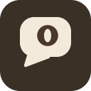

# ZooChattr



A portable Windows 11 desktop app for reading several Twitch chats at once, old-school multi-channel IRC style, with a gecko soul. Log in with Twitch to chat back. Twitch, 7TV, BetterTTV and FrankerFaceZ emotes render inline.

Built with Tauri 2, React, TypeScript and Tailwind. No backend of its own: it talks to Twitch chat over the official IRC WebSocket and pulls emotes from the public emote APIs.

**Download:** grab `ZooChattr-portable-<version>.zip` from [Releases](https://github.com/gecko-of-shadow/ZooChattr/releases/latest), unzip it anywhere, and run `ZooChattr.exe`. Each release is built on Windows by the [Release workflow](.github/workflows/release.yml).

## What it does

- **Many channels, one window.** Follow as many Twitch chats as you want. Connections stay open while the app runs, and drops are recovered automatically with backoff.
- **Two reading modes.**
  - **Grid:** up to four channels on screen in their own boxes. Extra follows stay tucked in the sidebar until you pin them or open Focused.
  - **Focused:** one channel at a time. The others show unread counts, plus an eye badge when someone mentions you.
- **Lives in the tray.** Closing the window keeps ZooChattr running in the system tray, so chats stay connected; the tray tooltip counts your mentions. Right-click the tray icon and choose Quit to get a confirmation (or turn close-to-tray off in Settings). Opening the exe again brings the running copy back instead of starting a second one. Optional **Start with Windows**.
- **Chat as yourself.** Log in with Twitch's device login (type a code at twitch.tv/activate; your password never touches ZooChattr). Press Enter to send, `/me` works, and ↑/↓ recall what you sent. The composer shows emote-only, followers-only, subs-only and slow mode.
- **Emotes everywhere.** Twitch emotes come from chat tags. 7TV, BetterTTV and FrankerFaceZ load global and channel sets for every joined channel, including zero-width overlay emotes. If a provider is down, its emotes are skipped and the smiley chip in the channel header says why.
- **Emotes your way** (the favourite bits of the Geckmotes browser extension, built in):
  - **Emote menu.** The animal button next to the message box opens a compact vertical list (bigger pictures + names), with tabs for ★ / Channel / All and a search box. Scroll loads more so big packs don't freeze. Right-click any emote to favourite it.
  - **Tab finishes emote names.** Type the first letters and press Tab; Tab again, or the arrow keys, cycles the matches (Shift+Tab goes back), or click one in the strip above the box. Names that start with what you typed come first, then names that contain it.
  - **Size and motion.** Draw emotes at 1×, 1.5× or 2×. Moving emotes can play always, only while pointed at, or never (still frames from each provider).
  - **Switches for everything.** Turn each source on or off, keep or drop overlay emotes, block emotes by name so they stay plain words, and toggle the hover preview.
  - **Remember emotes.** Emote lists are kept on this device (channel sets for an hour, global sets for twelve) so pictures show the moment a channel opens, then refresh in the background. One button forgets them all.
- **Reading comfort.** Any chat text size from 10 to 40px (emotes scale with it), extra highlight words that light up messages and count as mentions like your name does, and deleted messages kept readable (faded and crossed out) or hidden, your choice.
- **Mention sound.** Optional, off until you turn it on. A short chime when your name, a reply to you, or a highlight word shows up in any open chat (including ones sitting in the sidebar). A cooldown, from 1 to 120 seconds, keeps a busy room from chiming on every line. Settings → Chat display has a Play button so you can hear it first.
- **Per channel.** Switch any of the emote sources, the menu, Tab completion, preview, highlight words or deleted-message display off for one channel only, without changing your global switches.
- **Problems.** When a 7TV, BetterTTV or FrankerFaceZ download fails, Settings keeps the last 20 so you can see why emotes went quiet; Clear empties the list.
- **IRC feel.** Dense dark log with timestamps, badges, name colors (lifted for readability), reply context, sub/raid events, first-time-chatter eggs, moderator deletions, and links that open in your browser.
- **A zoo of themes.** Crested gecko, Penguin, Sea turtle and Elephant, each with its own animated mascot, colors, background texture (gecko scales, snowfall, shell plates, elephant wrinkles) and a little personality: the send button chirps, squawks, bloops or trumpets. Settings also has appearance themes: Dark, Light, Deuteranopia, Protanopia, Tritanopia, and Eye comfort. More animals are on the way.
- **Remembers you.** Channels, reading mode, theme, favourites, window position and every preference survive restarts. Back them up to a JSON file, restore that file on another machine, or reset to the defaults from Settings → Storage. Your Twitch login is never part of a backup. The window position is stored beside settings and is written after you finish dragging, not on every pixel.
- **Right room.** With "Confirm channel before typing" on (the default), each message box stays locked until you press "Switch to #channel", so a message does not land in the wrong chat when several are open.
- **More room for chat.** In Grid view, hide the sidebar and top bar with one click so the chat boxes fill the window; a floating button brings them back.
- **Chat history.** Keeps about 48 hours of messages per channel in `ZooChattr-data/chat` so logs come back after you quit (toggle in Settings).
- **Updates.** Checks GitHub for a newer portable build on launch (and every few hours); Settings still has a manual check. Install keeps your data folder.
- **Portable.** One `.exe` and nothing to install. Settings live in a `ZooChattr-data` folder next to it. Unzipping a new release over the old folder (or using in-app update) replaces only the exe and keeps your channels.

## Run it in development

Prerequisites:

- [Node.js](https://nodejs.org/) 20+.
- [Rust](https://rustup.rs/) (stable).
- On Windows: the "Desktop development with C++" workload from Visual Studio Build Tools. WebView2 is already part of Windows 11. See [Tauri's prerequisites](https://tauri.app/start/prerequisites/) for other platforms.

```bash
npm install
cp .env.example .env        # Windows: copy .env.example .env
npm run tauri dev
```

The desktop window opens with hot reload. `npm run dev` runs only the UI in a browser at http://127.0.0.1:17420. That's handy for styling, but logins aren't saved between browser sessions.

## Set up Twitch login (Client ID)

Reading chat works with no setup (anonymous, read-only). Sending needs a Twitch Client ID:

1. Open the [Twitch Developer Console](https://dev.twitch.tv/console/apps/create) and register an application.
2. **Name:** anything unique, e.g. `ZooChattr (yourname)`.
3. **OAuth Redirect URLs:** `http://localhost`. ZooChattr uses Twitch's device-code login and never redirects, but the form requires a URL.
4. **Category:** Chat Bot (or Application Integration).
5. **Client Type:** **Public**. This matters: public clients can use device login and refresh tokens without a client secret, which a desktop app can't keep secret anyway.
6. Copy the **Client ID** into `.env`:

   ```bash
   TWITCH_CLIENT_ID=your_client_id_here
   ```

   It's baked into the build, so friends who get your `.exe` can log in without any setup. You can also paste a Client ID at runtime in **Settings → Twitch account**, which overrides the built-in one.

ZooChattr asks only for `chat:read` and `chat:edit`. It re-validates the token every hour, as Twitch requires, and refreshes it automatically when it expires.

### Where the login is stored

| Platform | Token storage |
| --- | --- |
| Windows | Windows Credential Manager, generic credential `twitch-session.ZooChattr` |
| macOS | Keychain |
| Linux (dev only) | Kernel keyring, cleared when you log out of your desktop session |

The token is never written into the portable folder. **Log out** in ZooChattr revokes it on Twitch and deletes it. If the credential store refuses to save it, ZooChattr keeps the login for the current session only and tells you.

## Build the portable .exe

On Windows, from the repo root:

```bash
npm install
npm run build:portable
```

That runs `tauri build --no-bundle` (a release build with the UI embedded in the binary, no installer) and then collects the result:

```
release/
  ZooChattr-portable/
    ZooChattr.exe      ← the whole app (about 3.5 MB)
    README.txt
  ZooChattr-portable-0.3.3.zip
```

Copy `ZooChattr-portable` anywhere, such as a USB stick or Dropbox, and double-click `ZooChattr.exe`. On first run it creates `ZooChattr-data\` next to itself, holding `settings.json` and the WebView cache. If the folder isn't writable (e.g. under Program Files), it falls back to `%APPDATA%\com.geckoofshadow.zoochattr`. Settings shows which location is in use.

Before giving your copy to someone else, delete `ZooChattr-data\`: it holds your channel list and browser cache. Your Twitch login isn't in it.

The exe isn't code-signed, so SmartScreen may say "Windows protected your PC". Click **More info → Run anyway**.

### Publishing a release

Push a version tag and GitHub builds the exe on Windows and attaches the zip to a new release. The workflow then deletes every older release. Git tags stay, so older source is still reachable:

```bash
npm version patch          # bumps package.json (the app reads its version from there) and tags it
git push && git push --tags
```

That commit and tag carry your git name and email. To keep your real email out of the public history, first set `git config --global user.email` to your GitHub noreply address (GitHub → Settings → Emails, also turn on **Keep my email addresses private**).

To bake your Twitch Client ID into release builds, add it as a repository variable named `TWITCH_CLIENT_ID` (Settings → Secrets and variables → Actions → Variables). It's public by design, so a variable is fine; no secret is needed.

### Cross-compiling from Linux or macOS (experimental)

Tauri can build the Windows exe without Windows using [cargo-xwin](https://github.com/rust-cross/cargo-xwin). It produces the same portable `ZooChattr.exe`, but try it on a Windows machine before sharing it.

```bash
rustup target add x86_64-pc-windows-msvc
cargo install --locked cargo-xwin
# Debian/Ubuntu: sudo apt install clang lld llvm   (needs llvm-rc and lld-link)
npm run build:windows-cross
```

## Test without a Twitch account

`scripts/mock-twitch.mjs` is an offline stand-in for Twitch. It provides device login (auto-approved), token validate/refresh/revoke, the Helix calls ZooChattr makes, small 7TV / BTTV / FFZ emote sets (with pictures served locally, so the emote menu and Tab completion work offline), and an IRC server that behaves like Twitch where it matters: one command per frame, no echo to the sending connection, `USERSTATE` after sends, `NOTICE` on failures, `CLEARMSG` on demand.

```bash
npm run mock:twitch     # terminal 1
npm run dev:mock        # terminal 2: browser UI on http://127.0.0.1:17440, wired to the mock
npm run e2e:mock        # terminal 3: drives the whole flow in headless Chrome
npm run tauri:mock      # or: the desktop app wired to the mock
```

Other checks:

```bash
npm test                # unit tests (IRC parser, reconnects, emote parsing, tokenizer…)
npm run typecheck
cd src-tauri && cargo test
SOAK_URL=http://127.0.0.1:17420 SOAK_MINUTES=60 SOAK_CHANNELS=xqc,summit1g npm run soak   # live soak, logs to soak/
```

The e2e and soak scripts use `playwright-core` with an installed Chrome. Set `CHROME_PATH` if yours isn't at `/usr/local/bin/google-chrome`.

## Configuration reference

| Variable | Where | Purpose |
| --- | --- | --- |
| `TWITCH_CLIENT_ID` | `.env` | Public Client ID used for login. Empty means read-only mode until one is set in Settings. |
| `VITE_TWITCH_IRC_URL` | `.env` / `.env.mock` | Chat endpoint. Defaults to `wss://irc-ws.chat.twitch.tv:443`. |
| `VITE_TWITCH_AUTH_BASE` | `.env` / `.env.mock` | OAuth endpoint. Defaults to `https://id.twitch.tv`. |
| `VITE_TWITCH_HELIX_BASE` | `.env` / `.env.mock` | Helix API. Defaults to `https://api.twitch.tv/helix`. |
| `VITE_7TV_API`, `VITE_BTTV_API`, `VITE_FFZ_API` | `.env` | Emote API overrides (rarely needed). |
| `ZOOCHATTR_DATA_DIR` | runtime env | Forces the data folder, e.g. for testing a clean profile. |

Only `.env.example` and `.env.mock` are committed. `.env` is git-ignored.

## How it works

- **Two IRC connections**, the same way Chatterino does it. The *read* connection joins every channel; it's anonymous (`justinfan…`) when logged out and authenticated when logged in. The *write* connection only sends. Twitch echoes your message back on the read connection with full emote tags, and ZooChattr swaps that echo in for its local "sending…" copy. A `NOTICE` (rate limit, followers-only, etc.) marks the message as not sent and shows the reason.
- **Reconnects:** exponential backoff with jitter (1s → 30s), immediate retry when Windows reports the network is back, honoring Twitch's `RECONNECT`, and a keepalive ping that catches dead sockets after sleep or Wi-Fi changes. JOINs are paced under Twitch's rate limit.
- **Emotes:** `src/lib/emotes/` fetches 7TV (`7tv.io/v3`), BetterTTV (`api.betterttv.net/3/cached`) and FrankerFaceZ (`api.frankerfacez.com/v1`) global sets once, and channel sets whenever a channel is joined. Lookup order is channel over global, then 7TV › BTTV › FFZ. The registry applies your switches (sources, block list, overlays) when it builds each channel's lookup, and with "remember emotes" on it serves cached lists from `localStorage` first and refreshes stale ones in the background (`cache.ts`). Still frames use each provider's static URL (`…/1x_static.webp`, `…/static/1x.webp`, FFZ's plain `urls`, Twitch's `/static/`). Twitch's own emotes come from the `emotes` IRC tag, indexed by Unicode code point so emoji don't shift them.
- **Badges:** with a login, Helix provides exact global and channel badges (custom sub badges included). Anonymous mode falls back to Twitch's public images for broadcaster, mod, VIP, sub, Prime and similar.
- **Storage:** the Rust side (`src-tauri/src`) is deliberately small. It provides the portable data folder, atomic `settings.json` writes (a corrupt file is renamed aside, never deleted), and the OS credential store via the `keyring` crate.
- **Rules followed:** official Twitch IRC and Helix plus the documented public emote APIs only. No scraping of twitch.tv.

## From Geckmotes

The emote features above were ported from the Geckmotes browser extension and follow the same rules: each feature has its own switch, Tab completion ranks exact-case prefix matches first, then shorter names, then names that merely contain what you typed (50 at most), and favourites are stored as `provider:id` so a renamed emote stays a favourite. Where the code lives:

- `src/lib/emotes/providers.ts`: fetchers plus still-frame URLs. `registry.ts`: per-channel merge with the user's switches. `cache.ts`: the remember-emotes store. `search.ts`: the name index behind Tab and the picker's search.
- `src/components/chat/EmotePicker.tsx` (menu), `Composer.tsx` (Tab completion), `MessageRow.tsx` / `ChatLog.tsx` (sizes, animation, deleted rows, hover preview).
- `src/store/settings.ts`: the settings model, backup format and migration from older files.

Per-channel overrides and the Problems list live in Settings (same idea as Geckmotes' options page). The channel header's smiley chip still shows live provider status for the channel you're reading.

## Project layout

```
src/
  lib/irc/          IRC parser + reconnecting WebSocket connection
  lib/twitch/       message mapping, device login, Helix (badges, users)
  lib/emotes/       7TV / BTTV / FFZ providers and the per-channel registry
  lib/chat/         controller (connections, buffering, sending) + tokenizer
  store/            Zustand stores: chat state, settings, UI
  components/       chat log, composer, sidebar, dialogs, gecko art
src-tauri/          Rust shell: data folder, settings file, credential store
scripts/            mock Twitch, end-to-end run, soak test, portable packaging
```

## Troubleshooting

- **Blank window on Linux VMs:** start with `WEBKIT_DISABLE_DMABUF_RENDERER=1`.
- **"Twitch doesn't recognise this Client ID":** check for extra spaces, and make sure the app's Client Type is **Public**.
- **Login works but expires right away:** confidential (non-public) Twitch apps can't refresh without a secret. Switch the app to Public, or log in again when asked.
- **A channel stays on "Joining…" then errors:** the name is misspelled, or the channel is banned or deleted.
